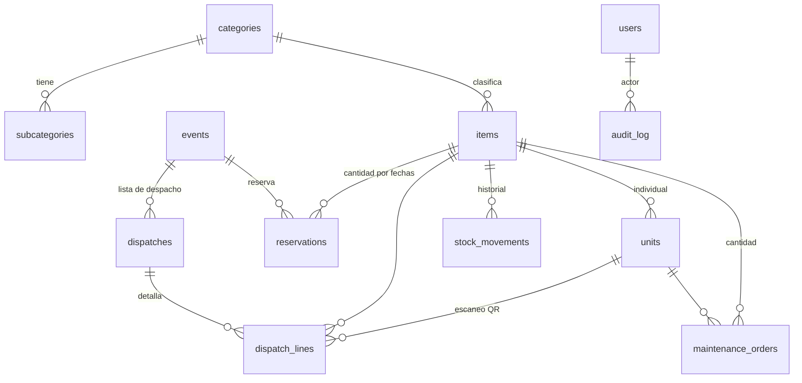

# Arquitectura de StageHub

## 1. Decisiones tecnológicas

| Capa | Elección | Por qué |
|---|---|---|
| Servidor | Node.js 22 (`node:http`) | Sin dependencias: instalación = instalar Node. Nada que se rompa al actualizar paquetes. |
| Base de datos | **SQLite** (módulo `node:sqlite`, modo WAL) | Relacional con transacciones ACID; un solo archivo fácil de respaldar; sin servicio que administrar. Un escritor a la vez evita por diseño las sobre-reservas concurrentes. Suficiente para decenas de usuarios simultáneos. |
| Esquema | Migraciones SQL numeradas | Cambios de esquema versionados; copia automática previa. |
| Frontend | SPA en JavaScript modular (ES modules), sin paso de compilación | Se sirve directo desde el backend. Sin CDN: funciona sin Internet. |
| Estilos | CSS propio, tema oscuro, responsive | Tailwind/React requieren compilar con red; se priorizó un sistema que se instale y ejecute con un comando. |
| API | REST + JSON | Cada módulo expone sus rutas; la lógica vive en `services/`. |
| Sesiones | Cookie HttpOnly + token aleatorio (se guarda su hash) | El token real nunca está en la BD. |

**Desviación respecto a lo sugerido:** se usa SQLite en lugar de MongoDB/PostgreSQL y JavaScript modular en lugar de React/Tailwind.
Motivo: el entorno de desarrollo no tenía acceso a Internet (no se podían instalar ni probar paquetes), y SQLite cubre mejor
la necesidad de integridad relacional con instalación mínima. Si más adelante necesitas PostgreSQL o React, la capa `services/` y la API REST
no cambian; solo se reemplaza el acceso a datos o la capa visual.

## 2. Estructura de carpetas
```
stagehub/
├─ server/
│  ├─ index.js            arranque, direcciones de red, respaldo diario
│  ├─ app.js              servidor HTTP, seguridad, enrutado, estáticos
│  ├─ config.js · db.js   configuración, SQLite, transacciones, migraciones
│  ├─ auth.js · users.js · permissions.js · audit.js · validate.js · http.js · backup.js · seed.js
│  ├─ migrations/         001_fase1_base.sql, 002_fase2_eventos.sql, …
│  ├─ routes/             un archivo por módulo (auth, catalog, items, dashboard, …)
│  └─ services/           reglas de negocio por módulo (inventory, catalog, photos, …)
├─ public/                index.html, css/, js/ (api, ui, charts, main, pages/)
├─ scripts/               create-user, backup
├─ tests/                 pruebas automáticas
└─ data/                  (se crea sola) stagehub.db, uploads/, backups/
```
Agregar un módulo = migración + `services/x.js` + `routes/x.js` + `public/js/pages/x.js` + una línea en `app.js` y `main.js`. No se toca lo existente.

## 3. Modelo de datos

### Implementado (Fase 1)
`users`, `sessions`, `categories`, `subcategories`, `items`, `units` (con `unit_number`, `status_note`, `status_changed_at/by` desde la migración 002), vista `v_item_stock`, `audit_log`, `stock_snapshots`, `settings`, `counters`.

### Planificado (migraciones futuras)

- `events` (nombre, cliente, lugar, fechas, montaje/desmontaje, responsable, estado, notas) y `event_staff`.
- `reservations` (event_id, item_id, qty) — una fila por equipo y evento.
- `dispatches` / `dispatch_lines` (despachado, devuelto, faltante, dañado, quién entrega/recibe, fecha/hora, unit_id si es individual).
- `maintenance_orders` (tipo, técnico, repuestos, costo, fechas, próxima fecha, estado).
- `stock_movements`: historial inmutable (reserva, salida, devolución, traslado, ajuste).
- `warehouse_id` en `items`/`units` queda previsto para multi-bodega.

### Cómo se relacionan
- Un **equipo** (`items`) pertenece a una categoría/subcategoría. Si es **individual** tiene N **unidades** (`units`), cada una con serie, token QR y estado propios; si es **por cantidad**, sus totales viven en el propio equipo.
- Un **evento** reserva **cantidades de equipos** (no unidades concretas). Las unidades concretas se asignan al **despachar** (escaneando QR).
- Todo cambio relevante escribe en `audit_log` con el usuario, dentro de la misma transacción.

## 4. Cálculo de disponibilidad
**Hoy (Fase 1):** `disponible_base = total − en_mantenimiento − fuera_de_servicio`
(individual: se cuentan unidades por estado; cantidad: se calcula de los campos). Siempre se calcula desde los datos, nunca se guarda duplicado.

**Desde la Fase 2**, para un equipo `I` y la ventana `[inicio, fin]` de un evento
(inicio = montaje, fin = desmontaje):

```
disponible(I, ventana) = disponible_base(I) − pico_reservado(I, ventana)
pico_reservado = máximo, en cada instante de la ventana, de la suma de reservas
                 de eventos activos (no cancelados ni finalizados) cuyas ventanas se solapan
```
- Se usa el **pico de concurrencia** (no la suma simple) para no bloquear eventos consecutivos que no coinciden.
- Un despacho no devuelto sigue contando como comprometido hasta registrar la devolución.
- Mantenimientos programados con fechas restan en su ventana.
- Reservar/modificar/trasladar corre en una transacción `BEGIN IMMEDIATE`: se recalcula y se valida **dentro** de la transacción, por lo que dos usuarios simultáneos no pueden sobre-asignar.
- Si hay conflicto, la API responde 409 indicando qué eventos chocan y cuántas unidades faltan.

## 5. Seguridad
- Validación completa en el backend (la interfaz solo ayuda). Errores 422 con campo afectado.
- Contraseñas con scrypt; sesiones con token aleatorio; límite de 8 intentos fallidos por usuario+IP cada 15 min.
- Cabecera obligatoria en escrituras + `SameSite=Lax` (anti-CSRF); CSP estricta; sin `innerHTML` con datos del usuario.
- Imágenes validadas por contenido real; fotos servidas solo con sesión.
- La BD no se expone por red. Para acceso remoto futuro: poner un proxy HTTPS (Caddy/Nginx) delante y activar `SECURE_COOKIES=1`.

## 6. Plan de fases
1. **Fase 1 (completa):** arquitectura, BD, autenticación, panel, inventario, categorías dinámicas.
2. Fase 2: eventos, reservas, disponibilidad por fechas, calendario.
3. Fase 3: despacho, devoluciones, movimientos, QR y etiquetas.
4. Fase 4: mantenimiento, usuarios y permisos (pantalla), reportes y exportaciones.
5. Fase 5: PWA, optimización móvil, respaldos desde la interfaz, pruebas generales.
